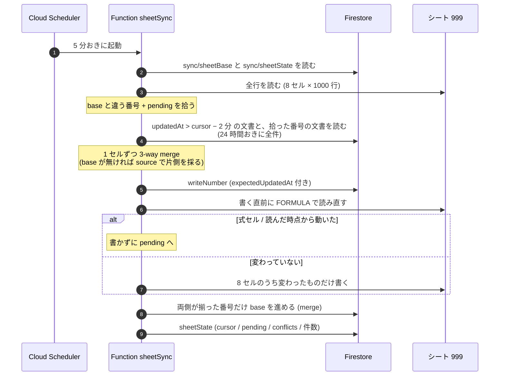
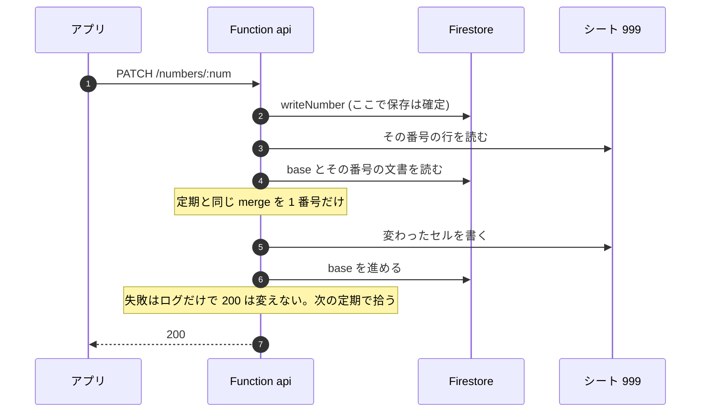

# design:sheet-bisync

シートと Firestore を**両方とも正本**にする (D-0021)。どちらで編集しても他方へ流れる。
`design:sheet-projection` (DB → シートの片方向) と `spec:sheet-to-db-sync`
(シート → DB の片方向) を、前回同期時の値 (base) を基準にした 3-way merge で置き換える。
語・かな・人・物については `spec:source-of-truth-switch` の «正本を 1 つに切り替える» もこれで不要になる。

## シート上の «編集できるセル»

シートの語セル (`wh1` など) は `=PICK_FIRST(B3,1)` の式で、`人` / `物` の一覧から
N 番目をそのまま取り出しているだけ。人が編集しているのは次の 8 セルで、同期の単位もこれ。

| field          | シート列    | DB 側                                                 |
| -------------- | ----------- | ----------------------------------------------------- |
| `hito`         | `人`        | `slots.wh1..3.word` (1〜3 番目) + `hito` (4 番目以降) |
| `mono`         | `物`        | `slots.wm1..3.word` (1〜3 番目) + `mono` (4 番目以降) |
| `wh1k`..`wm3k` | `wh1k` ほか | `slots.<slot>.kana`                                   |

アプリで語を直すと `slots` だけが変わり DB の `hito` は古いまま残る。そこで DB 側の値は
常に slots から組み立てる (`sheetFormOfDoc`)。式セル・`check`・`rankey` には書かない。

## 3-way merge (1 セルずつ)

| sheet  | db            | 結果                                            |
| ------ | ------------- | ----------------------------------------------- |
| = base | = base        | 何もしない                                      |
| 変更   | = base        | シートの値を DB へ                              |
| = base | 変更          | DB の値をシートへ                               |
| 変更   | 変更 (同じ値) | 揃っているので base を進めるだけ                |
| 変更   | 変更 (違う値) | **衝突**。どちらも書かず報告し、base も進めない |

base が無い番号 (初回) は、DB の `source` が `app` なら DB、それ以外はシートを採る。
初回だけの規則で、採った結果は報告に出す。

## いつ流れるか (D-0022)

- 定期: Function `sheetSync` が 5 分おきに全体を回す。
- 即時: アプリの保存 (`PATCH /numbers/:num`) が通った直後に、その番号だけ同じ処理を回す。
  失敗しても保存は巻き戻さない (定期の回で拾う)。

### 定期 (5 分おき)

### 即時 (アプリの保存)

設定タブの «シート同期» は `GET /sync/status` で sheetState を見せ、«今すぐ同期» は
`POST /sync/sheet` で定期と同じ処理を 1 回まわす。

## 状態を見る (REQ-BI-010)

判定は `src/firestore/sync-status.js` に一本化し、アプリ (`GET /sync/status`)・`nr sheet:status`・シートの `sync` タブが同じものを見る。
重い順に エラー > 止まっている (定期の cursor が 15 分進まない) > 衝突あり > 未反映あり > OK。

- **内容の最終更新はソースごとに別に持つ** (D-0027)。Drive の更新時刻や `words.tsv` の mtime は、同期や `nr sync` の書き直しで内容と無関係に動くので使わない。
  - シート / DB: `sheetState.sources.{sheet,db}`。シートは指紋が変わったのを見た回の時刻、DB は `updatedAt` の最大。
  - PC: `nr sync` が `src/data/words.meta.json` に持つ。
- **指紋**: 10 番号ずつ 100 グループを各 2 文字 (FNV-1a の下位 12 bit) にした 200 文字 (`src/firestore/fingerprint.js`)。
  並べるとどの十の位が食い違うかが分かる。同期の書き込みを重ねた後の値で取るので、反映直後もシートと DB は一致する。
- **`sync` タブは中身が変わったときだけ書く** (D-0028)。回ごとに変わる値 (最終同期の時刻・読んだ件数) は載せず、«止まっている» はアプリと CLI だけで判定する。

## 読み取り量を抑える

毎回 1000 件読むと 1 日 29 万 read になる。DB は `updatedAt > cursor` の文書と、
シート側で base から動いた番号の文書だけを読む。読まなかった文書は base と同じ値とみなす。
この仮定を崩さないため、書き込みが片側で止まった番号は `pending` に積み、次の回で必ず読み直す。

## Invariants

- 書くのは上の 8 セルだけ。式の入ったセルには書かない (書く直前に FORMULA で読み直す)。
- シートへ書く直前に対象セルを読み直し、読んだ時点から動いていれば書かない (次の回へ)。
- DB への書き込みは `writeNumber` (expectedUpdatedAt 付き) を通る。`rep` / `ratings` を変えない。
- 画像 (`imageUrl` / `confirmedFor`) は語に付いて回る。語の位置が動けば一緒に動く。
- base は両側が同じ値になったセルについてだけ進める。
- 同じ内容で 2 回流しても書き込みは 0 件。
- シートに無い番号の行を作らない。DB に無い番号の文書を作らない (どちらも報告だけ)。

## Requirements

- REQ-BI-001: IF セルがシートでだけ変わった THEN THE SYSTEM SHALL その値を DB へ書く
- REQ-BI-002: IF セルが DB でだけ変わった THEN THE SYSTEM SHALL その値をシートへ書く
- REQ-BI-003: IF セルが両側で別の値に変わった THEN THE SYSTEM SHALL どちらも書かず衝突として報告する
- REQ-BI-004: WHILE 書き込む THE SYSTEM SHALL 式セルと派生列に書かない
- REQ-BI-005: IF 書く直前のシートの値が読んだ時点と違う THEN THE SYSTEM SHALL そのセルを書かない
- REQ-BI-006: WHEN 語の位置が変わる THE SYSTEM SHALL 画像を語に付けて動かす
- REQ-BI-007: IF 片側の書き込みが失敗した THEN THE SYSTEM SHALL base を進めず、次の回で読み直す
- REQ-BI-008: IF 同一内容で再実行された THEN THE SYSTEM SHALL 書き込みを 0 件にする
- REQ-BI-009: IF base が無い THEN THE SYSTEM SHALL DB の source が app なら DB を、それ以外はシートを採る
- REQ-BI-010: WHEN 同期が終わる THE SYSTEM SHALL 反映数・衝突・未反映を状態として残し、アプリから見られるようにする
