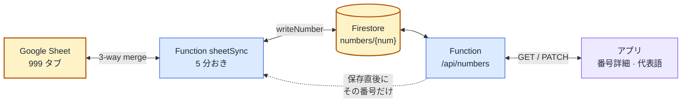
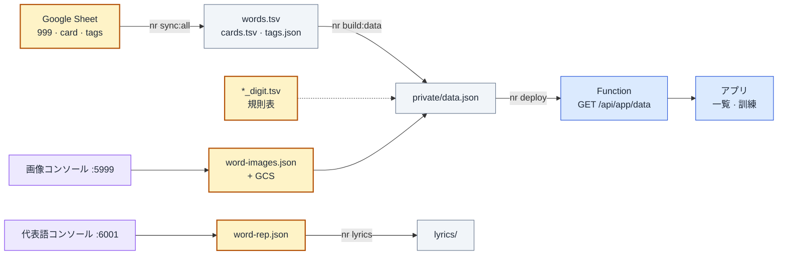
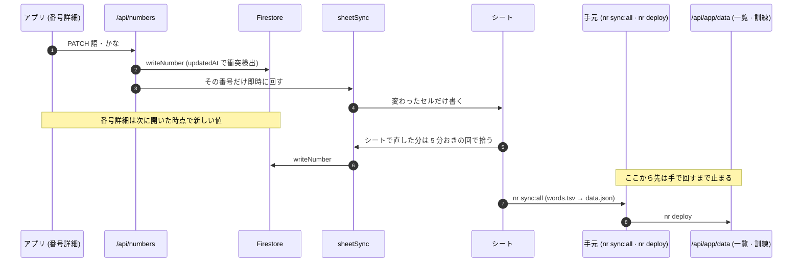
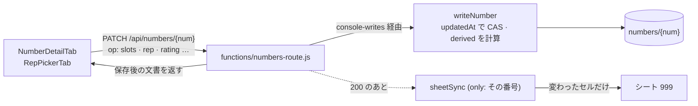
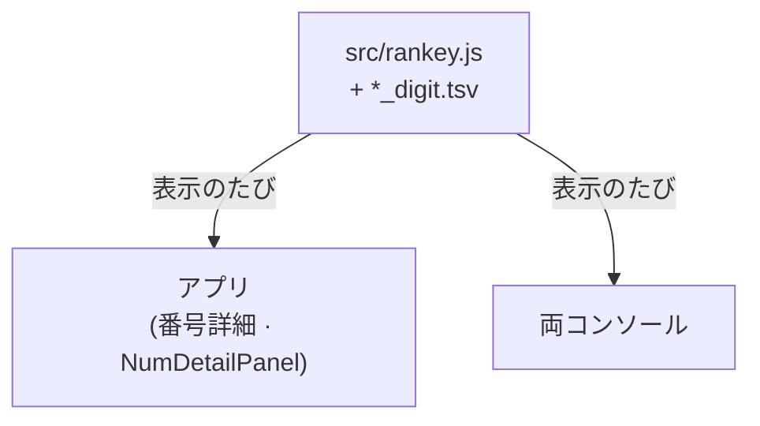

# データフロー全体像

999 数字暗記アプリの、Google Sheet / Firestore からアプリ表示までの全データの流れをまとめる。
「シートの各フィールド」「中間データ」「画像」「編集機能」を横断して記述する。

まず §0 の全体マップと §0.1 «編集が各画面に届くまで» を読めば、どこを直せばどこに出るかが分かる。

- Spreadsheet ID: `1F2G4-6lqUPeYzHkpbhUtYKgDzrjNuUo8tbjXKyrzFHM`（全スクリプト共通ハードコード）
- Firebase project: `anoz-memosupo`（`.firebaserc`）／ Functions region: `asia-northeast1`
- GCS バケット（画像）: `anoz-memosupo-words`

---

## 0. 全体マップ

語・かなの正本は **シートと Firestore (`numbers/{num}`) の 2 つ**で、Function `sheetSync` が
5 分おきに 3-way merge で揃える (D-0022)。どちらで直しても、もう片方へ流れる。
アプリが読む経路は 2 本あり、**一覧・訓練は手元で焼いた `data.json`**、**番号詳細と代表語は DB を直接**読む。

**図 1 — 同期 (自動で回る)**。シートとアプリのどちらで直しても Firestore を通って相手に届く。



**図 2 — 配信 (手で回す)**。一覧・訓練が読む `data.json` は手元で焼いて `nr deploy` で出す。図 1 の自動同期はここには届かない。



**読み方**

- **黄色が正本** (消えると戻らない)。シートは編集面と正本を兼ね、Firestore と双方向。
- **紫が人の触る面**、**青が Function / アプリ**、**灰色が手元の生成物** (`nr sync:all` で作り直せる)。
- 点線は «物は流れないが動きを起こす» 関係 (保存直後の即時同期、規則表による解釈)。

### 0.1 編集が各画面に届くまで

同じ編集でも、届く先によって速さが違う。**一覧・訓練は手元の `nr sync:all` → `nr deploy` を
通るまで古いまま**で、ここが一番遅い。



| 直した場所       | 番号詳細 (DB) | シート      | 一覧・訓練 (`data.json`)            |
| ---------------- | ------------- | ----------- | ----------------------------------- |
| アプリの番号詳細 | すぐ          | すぐ (即時) | `nr sync:all` → `nr deploy`         |
| シート           | 5 分以内      | —           | `nr sync:all` → `nr deploy`         |
| 画像コンソール   | 対象外        | 対象外      | `nr deploy` (manifest 経由)         |
| 代表語コンソール | 対象外 ※      | 対象外      | `nr lyrics` のみ (配信には載らない) |

※ 代表語コンソールはまだ `word-rep.json` に書く。アプリの代表語ピッカーは DB (`rep`) に書く。
2 つの正本の切り替えは `spec:source-of-truth-switch` で段階的に進める途中。

### 0.2 正本の一覧

| 正本                      | 中身                                                        | 編集手段                                 |
| ------------------------- | ----------------------------------------------------------- | ---------------------------------------- |
| Google Sheet              | 語・かな・タグ・カード                                      | シート / アプリ (Firestore 経由で双方向) |
| Firestore `numbers/{num}` | 語・かな (シートと同期) + 代表語 `rep` + 主観評価 `ratings` | アプリ (`/api/numbers`) / `sheetSync`    |
| `src/data/*_digit.tsv`    | かな → 数字の規則表。encode / score / rankey の全ての土台   | 手編集                                   |
| `src/data/word-rep.json`  | 代表語(①②)と主観評価 (DB へ移す途中の旧正本)                | 代表語コンソール (`nr console:rep`)      |
| `word-images.json` + GCS  | 確定画像                                                    | 画像パイプライン / 画像コンソール        |

`rankey` / `pt` / シートの `check` 列は **かな・語から計算できる派生値**で、正本ではない (§9)。

---

## 1. Google Sheet（正本の 1 つ。Firestore と双方向）

### タブ一覧

| タブ / gid                  | 主な列                                                                                                             | 用途                                                                                                 |
| --------------------------- | ------------------------------------------------------------------------------------------------------------------ | ---------------------------------------------------------------------------------------------------- |
| **999** (gid `0`)           | `num`, `hito`, `mono`, 各スロット `wh1/wh1k/wh1Img … wh3`・`wm1 … wm3`、各 `k` 列の**左隣 `check`・右隣 `rankey`** | 語呂本体。人(wh)/物(wm) × 語(word)/かな(k)/画像(Img)                                                 |
| **card** (gid `1530780723`) | `mark`, `person`, `action_p`, `score_p`, `object`, `action_o`, `score_o`, `action`, `score_a`                      | トランプ PAO。`score_*` は 0〜3                                                                      |
| **tags** (gid 参照は title) | `tag`, `title`, `short_title`, `count`, `hito`, `mono`, `gainen`, `nums`, `labels`                                 | `#tag` 集計。`title` / `short_title` を手動メンテ。名前は sheetSync で `sync/tagNames` (DB) にも写る |

### 999 タブの列の意味

| 列                  | 意味                                                                                  | 誰が書くか                             |
| ------------------- | ------------------------------------------------------------------------------------- | -------------------------------------- |
| `num`               | 3 桁数字（`/^\d{3}$/`）。データ行判定キー                                             | 人手                                   |
| `hito`              | 人物の語（`#tag` 記法可）                                                             | 人手 / アプリ (sheetSync 経由)         |
| `mono`              | 物・概念の語。**`gainen`(概念) は独立列を持たず `mono` に `#g` タグ付きで集約**される | 人手 / アプリ (sheetSync 経由)         |
| `whN` / `wmN`       | スロットの暗記語（word 本体）。`人`/`物` 一覧から式 `=PICK_FIRST(…)` で取り出す       | 式（書かない）                         |
| `whNk` / `wmNk`     | その語のかな読み。**エンコード・スコアの入力**                                        | 人手 / アプリ (sheetSync 経由)         |
| `whNImg` / `wmNImg` | 画像 URL                                                                              | 画像パイプライン経由（後述）           |
| `check`             | 監査フラグ（`[x]` 等）。各 `k` 列の**左隣**                                           | `sheet-audit.mjs` / `sheet-remark.mjs` |
| `rankey`            | 3 桁の内訳記法（`src/rankey.js`。旧 `pt` 列を置き換え）。各 `k` 列の**右隣**          | 使っていない (更新されない。D-0060)    |

> スロット列は `sheet-audit.mjs` が正規表現 `^(w[hm]\d)k$` で動的検出し、その左=`check`・右=`rankey`(旧 `pt`) を前提にする。**ヘッダ名やスロットの並びを変えると audit が例外で止まる**。

---

## 2. スロット名の 3 層（重要・混乱しやすい）

同じ「候補枠」が層によって別名で呼ばれる。

| 層                 | 名前                           | 枠数 | 備考                                                         |
| ------------------ | ------------------------------ | ---- | ------------------------------------------------------------ |
| Legacy             | `w1`, `w2`, `w1_2`, `w2_2`     | 4    | 旧スキーマ。**画像 manifest / GCS はこの名前でしか持たない** |
| シート/TSV（現行） | `wh1..wh3`(人), `wm1..wm3`(物) | 6    | `words.tsv` の実列                                           |
| Editor UI          | `wh1..wh5`, `wm1..wm5`         | 10   | 編集可能枠                                                   |

アプリ表示層のブリッジ（`app/data/parse.ts`, `app/lib/choice.ts`）:
`wh1←w1, wh2←w1_2, wm1←w2, wm2←w2_2`（wh3/wm3 は legacy 無し）。
→ **実体の画像 URL は常に legacy 4 枠で流れ、wh/wm はエイリアス**。wh3/wm3 の 3 候補目画像は現状 manifest に載らず未表示。

---

## 3. 同期スクリプト（シート ⇄ ローカル / Firestore）

読み取りは 2 系統: **無認証 export**（公開シート前提の `export?format=tsv` / `gviz csv`）と **認証 values API**（`src/google-sheets.js` 経由、ADC / service account / `GOOGLE_OAUTH_ACCESS_TOKEN`）。書き込み系は全て後者。

| スクリプト            | 読む                          | 書く                                                                              | 変換                                                      | npm                             |
| --------------------- | ----------------------------- | --------------------------------------------------------------------------------- | --------------------------------------------------------- | ------------------------------- |
| `sync-sheet.js`       | 999/gid0（無認証 TSV）        | `src/data/words.tsv`                                                              | 別名ヘッダ吸収、`splitConceptFields`、num 検証            | `sync`                          |
| `push-sheet.js`       | `words.tsv`                   | 999/gid0（**clear→ 全上書き**）                                                   | 行列化して `overwriteSheetValues`                         | `push`                          |
| `sync-tags.js`        | tags（無認証 CSV）            | `src/data/tags.json`                                                              | `tag→title` マップ                                        | `sync:tags`                     |
| `push-tags-sheet.js`  | `words.tsv` + tags 既存 title | tags（全上書き）                                                                  | `#tag` 集計、title 引き継ぎ                               | `push:tags`                     |
| `sync-card-sheet.js`  | card/gid（無認証 TSV）        | `src/data/cards.tsv`                                                              | `score_*` を 0〜3 正規化                                  | `sync:card`                     |
| `sheet-audit.mjs`     | 999/gid0（認証）              | 既定 dry-run→`sheet-audit.out.json`／`--write-rankey` で **rankey 列**            | かな採点＋`missing/digit/read/sokuon3` 判定               | （直接 node）                   |
| `sheet-remark.mjs`    | `sheet-audit.out.json`        | 既定 dry-run／`--write` で **かな(k)セル末尾にマーカー**                          | audit 結果を再鑑定・長音救済                              | （直接 node）                   |
| `sheet-bisync-cli.js` | 999/gid0 + Firestore          | 既定 dry-run／シート ⇄ Firestore の 3-way merge (Function `sheetSync` と同じ処理) | `--status` で同期の状態だけ表示                           | `sheet:bisync` / `sheet:status` |
| `db-sync.js`          | シート / `word-rep.json`      | Firestore (`--apply`)。代表語の移行・チャンク再構築                               | 片方向の `sync` 段は既定で回さない (双方向に置き換え済み) | `db:plan` / `db:push`           |
| `score-words.js`      | `words.tsv` のみ              | 標準出力のみ                                                                      | 完成度・スコア集計表示                                    | `score`                         |

### ⚠️ 運用上の gotcha

- **`push` は 999 タブを clear→ 全上書き**し、書くのは `words.tsv` の 21 列のみ。→ **`sync`→`push` の往復でシート上の `check` / `pt` / スロット 4 以降 / その他手動列が消える**（sync 時点で読み込んでいないため復元不可）。**rankey を書いた後に `push` を流すと rankey が飛ぶ**ので注意。
- `gainen` はシート上「mono 列 + `#g` タグ」に正規化されており、独立列としては保存されない。読み出し時に `splitConceptFields` で復元。
- `sheet-remark.mjs` は単独では動かない（`sheet-audit.mjs` が出す `sheet-audit.out.json` が入力）。実行順依存。両者とも npm script 未登録。
- 書き込みはデフォルト dry-run（`--write-rankey` / `--write` 必須）。安全側だが忘れると無反映。
- `score` はシート非接触の純ローカル集計（同期フローの外）。

---

## 4. 中間データファイル（`src/data/`。★=source of truth、他は派生）

| パス                                                       | 主要フィールド                                                                                                                                                    | 生成元                  | 消費者                                             | 種別                |
| ---------------------------------------------------------- | ----------------------------------------------------------------------------------------------------------------------------------------------------------------- | ----------------------- | -------------------------------------------------- | ------------------- |
| `words.tsv`                                                | num, hito, mono, wh1-3/wm1-3 × 語/よみ/画像                                                                                                                       | `sync-sheet.js`         | `words.js#loadWords` → 各生成、`app/data/parse.ts` | ★ 語彙              |
| `cards.tsv`                                                | mark, person, action*\*, score*\*, object                                                                                                                         | `sync-card-sheet.js`    | generate-preview-data, parse.ts                    | ★ カード            |
| `single_digit.tsv` / `double_digit.tsv` / `long_digit.tsv` | 数字 → かな割当表                                                                                                                                                 | 手書き                  | `src/table.js`                                     | ★ ルール表          |
| `tags.json`                                                | 略語 → 正式名（`pr→プリコネ` 等）                                                                                                                                 | `sync:tags`/`push:tags` | 画像検索クエリ生成, UI                             | ★ 辞書              |
| `word-images.json`（manifest）                             | 対象 ID→slot ごと `{url,hash,sourcePage,sourceImageUrl,uploadedAt}`。ID は 3 桁=番号 / 4 桁=日付 / `AS` `10H` 等=カード (ランク+スート) (`src/images/targets.js`) | `fetch-word-images.js`  | generate-preview-data が `*Img` に merge           | ★ **最終画像 SoT**  |
| `word-images.candidates.json`                              | 画像候補 URL/query/status                                                                                                                                         | `search-word-images.js` | fetch の入力                                       | 中間                |
| `word-images-keep.json`                                    | ロック集合 `"num:slot": true`                                                                                                                                     | `keep-all.js` / console | search/fetch の上書き保護                          | 制御 state          |
| `word-images-redo.json`                                    | やり直しフラグ                                                                                                                                                    | console / CLI           | fetch `--redo-only`                                | 制御 state          |
| `word-rep.json`                                            | `rep`(代表語 picks + confirmed) / `scores`(主観評価 -1/0/+1/+2)                                                                                                   | 代表語コンソール        | `gen-words-lyrics.js`                              | ★ **選択の SoT**    |
| `visualize-words.data.json`                                | `{ data:[row…], ruleStats }`                                                                                                                                      | **`generate-viz.js`**   | generate-preview-data, stats HTML                  | 生成物（gitignore） |
| `visualize-words.data.sample.json`                         | 同構造（sample 由来）                                                                                                                                             | generate-viz            | 公開デモ                                           | 生成物（commit 済） |
| `words.json`                                               | num, w1, w1k, w2, w2k                                                                                                                                             | 旧エクスポート          | **未使用（レガシー・未追跡）**                     | 旧派生物            |

> `words.json` は git 未追跡・現行チェーン未使用・旧スキーマの残骸。source of truth は `words.tsv`。

### `word-rep.json` だけは git 追跡

`src/data/` の大半は gitignore（シートから再生成できるため）だが、`word-rep.json` は
**シートに存在しない情報**なので追跡している。消えると復元できない。

```json
{
  "version": 2,
  "rep": {
    "051": { "picks": [{ "k": "こい", "w": "鯉" }], "confirmed": true }
  },
  "scores": { "051": [{ "k": "こい", "w": "鯉", "v": 2 }] }
}
```

スロット位置(`wh1` 等)ではなく **「読み+語」の値で保存**する。`words.tsv` の候補が
並び替わっても選択がズレず、語が消えた／変わったときだけ `stale` として浮く
（黙って別の語にすり替わらない）。`picks` は最大 2 枠(①②)、`scores` は候補語ごとに
1 つ。未評価(キー無し)と `0`(普通)は別状態。

---

## 5. ビルドチェーン（中間データ → 配信用 data.json）

```
build
├─ build:data
│   ├─ node src/generate-viz.js           # words.tsv(+sample) → visualize-words.data(.sample).json
│   └─ node src/generate-preview-data.js  # viz.data.json + cards.tsv + table.js + word-images.json → private/data.json
└─ vite build                             # app/ をバンドル → dist/

build:preview = generate-preview-data.js + (stats.html 等を public/ へ cp)
sync:private  = private/data.json → functions/private/ へコピー
viz           = generate-viz.js 単体
deploy        = build:preview → build → sync:private → sync:functions → firebase deploy --only functions:api,functions:sheetSync,hosting
```

> デプロイの経路 (画面は CI、Function と辞書データは手元の `nr deploy`) と、アプリに届くまでの流れは [deploy.md](deploy.md)。

> 配信データは **`private/data.json`**。私的な辞書なので公開 hosting には置かず、
> `functions/private/` に同梱して**認証付き Function (`GET /api/app/data`) からのみ**
> 配信する。`private/` と `functions/private/` は gitignore。

### generate-viz.js（score の計算地点）

- 入力: `words.tsv`（+ sample）を `loadWords`
- 計算: `categoryScore`→`catScore`、`scoreWithLabel(w1k,w1)/(w2k,w2)`→`w1Score`/`w2Score`/`w1Pattern`（トークン記号列）・エラー時 `w1Error`/`w2Error`、集計 `ruleStats`（patterns / tokenTypes / kanaUsage / digitKanaAlloc / violations 等）
- 出力: `visualize-words.data.json`（本番, gitignore）と `.sample.json`（commit）
- **pt はここで計算される派生値**（`w1Score`/`w2Score`）。ルール表を変えたら、この経路を作り直す（→ `nr sync:all`）。rankey は配信データに入れず、アプリが計算する。

### generate-preview-data.js（配信データの組み立て）

- `visualize-words.data.json` の `.data`（zod 検証）→ `numbers`
- `cards.tsv`（mark を suit/rank 分解、score 0..3 クランプ）→ `cards`
- `table.js` + `scorer.WEIGHTS` → `rules`（singleByDigit / doubleMatrix / longMatrix / weights）
- manifest 画像を merge: `slots.w1.url → n.w1Img`（w2/w1_2/w2_2 も）。**書くのは legacy 4 Img のみ**
- `goro-extract.classify` で各 num のゴロ割当 `ga`（t1..t4=下 2 桁 / h1..h4=上 2 桁）を事前計算
- 出力: `private/data.json = { numbers, cards, rules }`（minify）

---

## 6. 画像パイプライン

流れ: `words.tsv` の語 → **search**（URL 探索）→ candidates → **fetch**（DL→webp→GCS）→ manifest → generate-preview-data で `*Img` に合流 → アプリ表示。keep/redo で一括処理を制御。

| スクリプト              | 入力                            | 取得元                                        | 出力                                                                                          | npm                                                                                 |
| ----------------------- | ------------------------------- | --------------------------------------------- | --------------------------------------------------------------------------------------------- | ----------------------------------------------------------------------------------- |
| `search-word-images.js` | words.tsv, tags.json, keep/redo | DuckDuckGo 画像（既定, キー不要）/ Google CSE | `word-images.candidates.json`（**URL のみ**）                                                 | `images:search`（w1, 90 件）／`images:retag`（tag 展開で語が変わった分, slot both） |
| `fetch-word-images.js`  | candidates の found URL         | candidates の imageUrl を DL                  | 400x400 **webp** 化 →content-hash key `words/<sha20>.webp`→**GCS upload**→manifest 記録。冪等 | `images:fetch`（全件）／`images:redo`（`--redo-only`）                              |
| `keep-all.js`           | manifest                        | —                                             | manifest 全件を `word-images-keep.json` にロック（`--clear` で解除）                          | `images:keep-all`                                                                   |
| `avatar-i-images.js`    | viz.data.json の `#i`（身内）枠 | DiceBear API                                  | 名前ラベル付き webp→GCS→manifest→ 自動 keep                                                   | `images:avatar-i`                                                                   |

- ストレージ: バケット `anoz-memosupo-words`（env `WORDS_BUCKET`）、key `words/<sha256先頭20hex>.webp`、公開 URL `https://storage.googleapis.com/anoz-memosupo-words/words/<hash>.webp`、`Cache-Control: immutable`。認証は SA 鍵 `.config/words-uploader.json`。`file.exists()` で既存 skip（冪等）。
- **manifest（`word-images.json`）が確定本体**、candidates は候補にすぎない。keep はロック、redo はやり直しフラグ。すべて legacy スロットキーで保存。
- 画像 state ファイルは全て `.gitignore`。**GCS 上の webp が実配信元、manifest がローカル索引**の二層構成。

### console/（ローカル画像レビュー UI）

`console/server.js`（既定 `PORT=5999`, `npm run console`）はファイル書込のためローカル専用。

- `GET /api/state`: words.tsv(→legacy 変換) + manifest + candidates + redo + keep をマージ
- `POST /api/redo` / `redo-now`（該当スロットだけ再検索 → 再取得）/ `keep` / `recrop`（上寄せ再クロップ）/ `search-custom`（任意語で再取得）/ `set-image`（2 択の差替）
- `console/build-static.js`（`npm run gallery:build`）: 閲覧専用ギャラリーを `dist-gallery/` に生成（`state.json` に焼込、API 無しなら read-only フォールバック）。→ bayalhost 配信（[project memory: Words Gallery Deploy]）

#### 画像が「語と合っていない」状態の検出

`word-images-keep.json` は `"001:w1": true` という真偽値だけで、**どの語に対する確定かを
持たない**。そのため sync でシートの語が差し替わっても確定が外れず、前の語で取った画像が
残る。`word-images.candidates.json` には検索時の語が `word` として残っているので、
現在の語と突き合わせて検出する（`console/app.js#wordChanged`）。

タグが付いただけ（`嫌` → `嫌#g`）は無視し、`extractName` 相当で本体が別語になったもの
（`鶴` → `振る`）だけを `⚠️語変更` として出す。フィルタで絞れる。

#### `#i`（プライベートな友人）は固定枠

`/#i\b/` の語は DiceBear アバター（`images:avatar-i`）で固定。実写に差し替わると困るので
コンソールからは操作できない（常に確定表示、ボタンを出さない）。`#ipra` には誤爆しない。

---

## 6.5 代表語コンソール（`nr console:rep`）

`console/rep-server.js`（既定 `PORT=6001`）。ファイル書込のため loopback 限定。
`word-rep.json` を読み書きする唯一の UI。

- `GET /api/state`: `src/rep-store.js#buildRepState`。候補(人 wh1-3 / 物 wm1-3)に
  `rankey` / `pt` / 画像 / 主観評価をマージして返す
- `POST /api/rep {num, order, confirmed}`: 代表 ①② を保存
- `POST /api/score {num, slot, v}`: 候補語 1 件の主観評価（`v=null` で未評価に戻す）

**2 つの軸は独立**している。代表(picks)を決めても評価は動かず、評価しても確定状態は
動かない。書込は `writeJson`（tmp→rename）でアトミック。

#### 多重起動は拒否する（単一インスタンス）

`console/rep-lock.js` が checkout ごとのロックを `$TMPDIR` に取る。**ポートが違っても**
2 個目は起動できず、こう出て終わる（起動中のサーバは落とさない）:

```
rep console: already running at http://127.0.0.1:6001 (pid 75699)
  止めるなら: nr console:kill
```

`PORT` を変えた背後起動は EADDRINUSE をすり抜けるので、これが無いと 1 プロセス
130MB 級が居残り続ける。`kill -9` で残った stale ロックは pid とコマンド名を見て
奪うため、手で消す必要はない。居残りの確認は `nr console:ps`。

確定が増えたら `nr lyrics` で `lyrics/` を再生成する必要がある（`sync:all` に含む）。

---

## 7. アプリ実行時（Firebase Hosting）

- 起動: `app/App.tsx` → `app/lib/appDataApi.ts#fetchAppData` が `GET /api/app/data` を **Bearer トークン付き**で叩く（`editToken999`）→ `validateAppData`（`AppDataSchema`）。401 なら `LockedScreen` に倒す。辞書本体は公開 hosting に無い。
- 番号詳細 (`NumberDetailTab`) と代表語ピッカー (`RepPickerTab`) は `data.json` ではなく `/api/numbers` で Firestore を直接読む (§8)。そのため一覧と詳細で値が食い違うことがある (一覧は `nr deploy` まで古い。§0.1)。
- `data.json` = `{ numbers, cards, rules }`。schema 主要フィールド:
  - `NumberEntrySchema`: num, w1/w1k/w2/w2k, hito/mono/gainen, catScore, w1Score/w1Pattern/w1Error, w2Score/w2Error, w1Img/w2Img, w1_2/w2_2(+Img), wh1..wh3(+k/Img), wm1..wm3(+k/Img), `ga`(ゴロ割当)
  - `CardEntrySchema`: suit(S/H/C/D), rank, person, actionP, personScore, object, actionO, objectScore, action, actionScore
  - `RulesDataSchema`: singleByDigit, doubleMatrix, longMatrix, weights

### タブとデータソース（`app/components/`）

すべて `data.numbers` / `data.cards` / `data.rules` を読む。

| タブ                           | 表示                                            | ソース                     |
| ------------------------------ | ----------------------------------------------- | -------------------------- |
| NumberTab（全体）              | 000〜999 を桁フィルタ                           | numbers                    |
| DigitTab（2 桁）               | upper/lower/mid/digit 抽出                      | numbers                    |
| NumMapTab                      | 100 帯マップ                                    | numbers                    |
| CardTab                        | トランプ 52 枚 閲覧/連想/選択                   | cards                      |
| PiTab / YearTab / WeekdayTab   | π/年号/曜日トレーニング                         | numbers                    |
| BookmarkTab                    | ブックマーク（`n:`番号 / `c:`カード）           | numbers/cards + bookmarks  |
| NumDetailPanel                 | 番号 1 件詳細（語・かな・画像・タグ）共有パネル | numbers                    |
| NumberDetailTab / RepPickerTab | 番号詳細の編集 / 代表語の選択                   | `/api/numbers` (Firestore) |
| RecordPanel                    | テスト記録オーバーレイ（共有）                  | 呼び出し元の Record[]      |

### ローカル永続状態（localStorage、`app/data/storage.ts`）

単語データ本体以外は全て localStorage。

| 状態                      | キー                                                              |
| ------------------------- | ----------------------------------------------------------------- |
| ブックマーク              | `bm999`                                                           |
| 現在タブ                  | `tab999`                                                          |
| 編集トークン              | `editToken999`（URL の `edit_token`/`editor_token` から取り込み） |
| π / 年号 / D3 / 曜日 記録 | `pi999` / `year999` / `d3-999` / `weekday999`                     |
| カード 記録/統計/設定     | `card999` / `cardStats999` / `cardTrainSettings999`               |

---

## 8. 編集機能（アプリ → Firestore → シート）

アプリの編集は **番号詳細 (`NumberDetailTab`) と代表語ピッカー (`RepPickerTab`)** から、
`/api/numbers` を通して Firestore に書く。シートへは `sheetSync` が流す。



| メソッド/パス                    | 処理                                                | 対象                     |
| -------------------------------- | --------------------------------------------------- | ------------------------ |
| `GET /api/numbers/{num}`         | 番号 1 件の文書                                     | Firestore read           |
| `PATCH /api/numbers/{num}`       | 1 番号の 1 操作。衝突は 409                         | Firestore write → シート |
| `GET /api/numbers?hundred=N`     | 百の位 1 つぶん (代表語ピッカーの一覧)              | Firestore read           |
| `GET /api/sync/status`           | 同期の状態 (最終実行・衝突・未反映)                 | `sync/sheetState`        |
| `POST /api/sync/sheet`           | 同期を今すぐ回す (設定 > 同期)                      | シート ⇄ Firestore       |
| `GET` `PATCH /api/editor/words…` | 旧経路。シートを直接読み書き (`EditorTab` は未使用) | シート                   |

- 書き込みは必ず `console-writes` を通す。文書を組み立てて上書きすると `rep` / `ratings` を消せてしまうため。
- `derived` (`ptBySlot`) は書き込み口が計算する。rankey は保存しない (D-0045)。クライアントからは書けない (REQ-FS-005)。
- 保存直後の即時同期が失敗しても保存は巻き戻さない。5 分おきの定期の回が拾い直す。
- 同期の仕組みは `.vsdd/firestore-store/specs/design-sheet-bisync.md`、API は `spec-number-api.md`。

---

## 9. 評価値の 3 系統（score / rankey / 主観評価）

かなに対する「評価」は 3 つある。**別物なので混同しない**。

|                | 実体       | 誰が決める                     | どこに出る                                        | 用途                   |
| -------------- | ---------- | ------------------------------ | ------------------------------------------------- | ---------------------- |
| **pt (score)** | 数値       | `src/scorer.js` の重み付き総和 | `data.json` の `w1Score`/`w2Score`                | 候補の**並び替え**基準 |
| **rankey**     | 文字列     | `src/rankey.js`                | 見る場所ごとに計算 (下の «rankey を計算する場所») | 3 桁の**内訳**を読む   |
| **主観評価**   | -1/0/+1/+2 | **人間**                       | `word-rep.json` の `scores`                       | 「この語呂はアリか」   |

pt と rankey はどちらも **かな + 語からの純粋な派生値**で、入力には戻らない（循環しない）。保存せず、見る場所で計算する (D-0045)。
主観評価だけは人間が入れるので、どこからも再生成できない。

### よみ (かなセル) の記法 (D-0062)

よみは基本ひらがなだけで書く。読み方を書き添える記法が 2 つある。正本は `src/kana-notation.js`。

| 記法   | 意味                                                 | 例                 | 表示 (アプリ)          | rankey |
| ------ | ---------------------------------------------------- | ------------------ | ---------------------- | ------ |
| `[す]` | 1 桁読み: 2 桁を読むかな (す=33) を 1 桁目だけで読む | `[す]うる` = 376   | す³うる (右肩に読む数) | `h`    |
| `(ん)` | 読まない: ( ) の中のかなは数字にしない (中間の省略)  | `さば(ん)な` = 387 | さば~~ん~~な (薄く)    | `!`    |

- 囲めるのはひらがな 1〜2 文字だけ。数字を自由に書ける記法 (`す^3` のような形) にしないのは、誤ったよみまで記号 1 つで通ってしまうから
- `す^3` は入力の記法ではなく、アプリが `[す]` を **す³** と表示している見た目のこと
- 記法の無いよみは、rankey が «かなを 1 文字飛ばせば番号に合う» を自動で探して `!` を付ける (`さばんな` = `AA!A|`)。
  どのかなを読まないかがよみに残らないので、`nr kana:skip` (dry-run、`--apply` で書く) で `さば(ん)な` に書き直す。
  書き直しても rankey が変わらないものだけを書く。`--apply` はシートの check 列の式も正本で書き直す
- 記法の付いたよみは書いた人が読み方を決めているので、自動の探索はしない

### rankey の記法

```
<3桁ぶんの記号(+中間省略 !)>|<接尾>

A/B/C  1文字1桁の core/sub/bad     みかみ = BCB|
w w    1文字2桁 (と=10) の2桁ぶん   きた   = Aww|
x      拗音の小書き側              しゅろ = AxA|
t      促音                        ろっし = AtA|
_      先頭0の省略                 れい   = _CA|
!      中間の省略                  りんご = ww!A|  (記法 り(ん)ご でも書ける)
h      記法 [す] の 1 桁読み        [す]うる = hBB|
v      2桁が3桁境界を跨ぐ          たま   = wwv|v
n/-/.  余り(ん / ー / その他)       にいさん = AAA|n
m      mix (同じ数字を別のかなで)
```

余りは「読みが 3 桁を超えた分」と「語が読みより長い分」の両方を指す。

### rankey を計算する場所 (D-0045)

シートの `rankey` 列は使っていない。アプリが計算するので、シートに表示する必要が無くなった (D-0060)。

rankey は **保存して配る値ではなく、見る場所ごとに `src/rankey.js` で計算する値**。
計算の実体は 1 か所 (`rankey.js` + 規則表) で、各所はそれを呼ぶだけ。DB にも配信データにも入れない。
アプリは規則表をバンドルに埋め込んで持つ (`src/rule-tsv.browser.js`。vite の alias で `rule-tsv.js` と差し替え)。



| 表示先     | いつ計算し直すか | 規則表を変えたら                  |
| ---------- | ---------------- | --------------------------------- |
| アプリ     | 表示のたび       | 画面を出し直す (main に入れば CI) |
| コンソール | 表示のたび       | 再起動                            |

> 以前は Firestore の `derived.rankeyBySlot` と `data.json` の `w1Rk`/`w2Rk` に保存していた。どちらもやめた (D-0058)。

### ルールを変えたら作り直す

`*_digit.tsv` や `scorer.js` を触ると pt と rankey の両方が変わる。かな → 値の
**一方向**なので、古い値は自動更新されない。

- 配信データの pt … `nr build:data`（`nr sync:all` にも入っている）
- rankey … 規則表が `src/data/*_digit.tsv` にあるので、main に入れば CI が出す画面に入る。Function とコンソールは出し直す

---

## 10. 認証情報（用途ごとに別の鍵）

| 用途                 | 環境変数                      | 既定                                  | 主体                                                  |
| -------------------- | ----------------------------- | ------------------------------------- | ----------------------------------------------------- |
| シート読み書き       | `GOOGLE_SERVICE_ACCOUNT_PATH` | `.config/google-service-account.json` | `.envrc` で `sheet-writer@drive-editor-501303` を指す |
| **画像アップロード** | `WORDS_UPLOADER_KEY`          | `.config/words-uploader.json`         | `words-uploader@anoz-memosupo`                        |

> ⚠️ かつて `src/images/upload.js` も `GOOGLE_SERVICE_ACCOUNT_PATH` を見ていたため、
> `.envrc` のシート用 SA が画像アップロードにも使われ、バケットへの
> `storage.objects.create` が無く **全ての画像取得が 403 で失敗**していた。
> 変数名を分離して解決済み。汎用的な名前の環境変数を複数用途で共有しない。

シートは非公開なので、無認証 export（`export?format=tsv` / `gviz csv`）は 401 を返す。
`sync-sheet.js` / `sync-tags.js` / `sync-card-sheet.js` はいずれも**無認証を試して
弾かれたら認証 API に落ちる**二段構え。

---

## 付録: npm scripts 早見表

| 分類         | script                                                                                                    | 役割                                                                               |
| ------------ | --------------------------------------------------------------------------------------------------------- | ---------------------------------------------------------------------------------- |
| **一括**     | **`sync:all`**                                                                                            | **sync → sync:tags → sync:card → lyrics → build:data を順に実行。通常はこれ 1 本** |
| 同期         | `sync` / `sync:card` / `sync:tags` / `push` / `push:tags`                                                 | シート ⇔ ローカル TSV/JSON                                                         |
| シート書戻し | `sheet:audit` (dry-run) / `sheet:rankey`                                                                  | 監査プラン出力 / rankey 列を書き戻す (使っていない)                                |
| DB 同期      | `sheet:bisync` / `sheet:status` / `db:plan` / `db:push` / `db:rules`                                      | シート ⇄ Firestore を手で回す / 状態 / 移行 / rules                                |
| 歌詞         | `lyrics`                                                                                                  | `lyrics/` を再生成（確定が増えたら都度）                                           |
| 画像         | `images:search` / `images:retag` / `images:fetch` / `images:redo` / `images:keep-all` / `images:avatar-i` | 画像 探索 → 取得 → ロック                                                          |
| ギャラリー   | `console` / `gallery:build`                                                                               | ローカルレビュー UI / 静的ギャラリー生成                                           |
| 生成         | `viz` / `build:data` / `build:preview` / `sync:private`                                                   | 中間 → `private/data.json` → `functions/private/`                                  |
| 検証         | `score` / `check:kana` / `check:digits` / `check:errors` / `test`                                         | ローカル集計・検証                                                                 |
| 開発/配信    | `dev` / `dev:api` / `build` / `deploy` / `deploy:api`                                                     | Vite / Functions エミュ / デプロイ                                                 |
