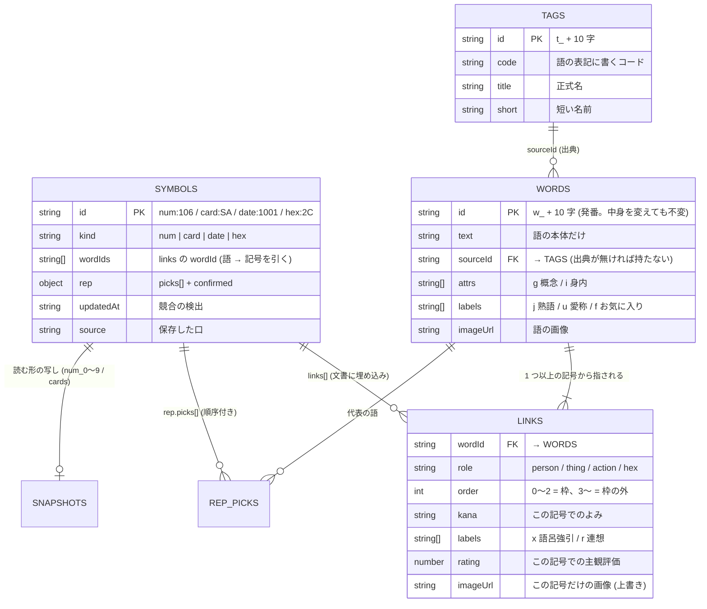

# DB 構造 (Firestore)

999 の辞書 (番号・カード・日付・FF に付ける語) を持つ Firestore の形。プロジェクトは `anoz-memosupo`。
正本は **symbols / words / tags** の 3 コレクション (DB v4)。本番の Function は `NUMBERS_SOURCE=symbols` / `DB4_WRITE=on` で動いている。

- 形の定義 (zod): `src/db4/schema.js`
- 中身の整合の検査 (C1〜C9): `src/db4/integrity.js`
- 区分・印・ID の表: `src/db4/roles.js` / `src/db4/marks.js` / `src/db4/ids.js`
- 書き込み口: `src/db4/write-layer.js` (形と整合を確かめてから書く。違反があれば transaction ごと止める)

Firestore は参照や一意性を守らないので、制約は書き込み口と検査で守る。

## 全体

## コレクション

| コレクション | 文書 ID | 中身 | 正本か |
|---|---|---|---|
| `symbols` | `num:106` など | 記号 (語を付ける相手) 1 件と、その語への結び付き `links[]` | 正本 |
| `words` | `w_xxxxxxxxxx` | 語 1 件 | 正本 |
| `tags` | `t_xxxxxxxxxx` | 出典タグ 1 件 (約 140 件) | 正本 |
| `snapshots` | `num_0`〜`num_9` / `cards` | 画面が読む形の写し。番号 100 件ずつ 10 文書と、カード 1 文書 | 写し |
| `meta` | `dbChange` / `backupState` | 最後に DB を書いた時刻 / 最後にバックアップした時刻 | 管理 |
| `sync` | `sheetBase` / `sheetState` / `tagNames` | シート同期の基準・状態、タグの名前 | 管理 |
| `passkeys` | 資格情報 ID | 登録済みパスキーの公開鍵。Admin SDK だけが触る (rules で全面拒否) | 認証 |
| `numbers` | `106` など | 旧 DB (文字列を詰めた形)。読み先を戻すときのためだけに残る | 旧 |

## symbols: 記号

語を付ける相手 1 件。`kind` で種類を分ける。

| kind | ID の形 | 例 | 備考 |
|---|---|---|---|
| `num` | `num:` + 3 桁 (ゼロ埋め) | `num:007` `num:106` | 000〜999 |
| `card` | `card:` + スート 1 字 + ランク | `card:SA` `card:S10` `card:HK` | スート S/H/C/D、ランク A 2〜10 J Q K |
| `date` | `date:` + 月日 | `date:1001` `date:1231` | 10〜12 月の 4 桁だけ (下の «日付と番号») |
| `hex` | `hex:` + 16 進 2 桁 (大文字) | `hex:00` `hex:2C` | FF |

| 欄 | 型 | 意味 |
|---|---|---|
| `links` | 配列 | 語への結び付き (次の節) |
| `wordIds` | string[] | `links` の `wordId` を並べたもの。«この語を使っている記号» を引くための索引 |
| `rep` | `{ picks, confirmed }` | 代表の語。`picks` は順序付きで数の上限なし、同じ語は 1 回。語に決まらない代表は `{ k, w }` (かな + 表記) のまま残す |
| `looseRatings` | 配列 | 語に結び付かない評価 (旧データの名残) |
| `kanaOnly` | 配列 | よみだけで語の無い枠 |
| `extras` | object | 旧 DB にあって新しい形で解釈しない欄 |
| `updatedAt` / `source` | string | 保存した時刻と口 |

### links[]: 記号 → 語の結び付き

| 欄 | 意味 |
|---|---|
| `wordId` | 指す語 |
| `role` | 区分。`person` 人 / `thing` 物 (num・date・card)、`action` 行動 (card)、`hex` 語 (hex)。番号とカードで同じコード。人/物は語ではなく結び付きに持つ |
| `order` | 0〜2 は枠 (1〜3 番目)、3 以降は枠の外 |
| `kana` | この記号でのよみ (同じ語でも記号ごとに違いうる) |
| `labels` | この記号での当てはまり: `x` 語呂強引 / `r` 連想 |
| `rating` | この記号での主観評価 (-1 / 0 / +1 / +2) |
| `imageUrl` | この記号だけで使う画像。空なら語の画像を使う |
| `slotExtras` / `act` / `raw` | 移行で残した欄 (解釈しない) |

## words: 語

| 欄 | 意味 |
|---|---|
| `id` | `w_` + 10 字 (`23456789abcdefghijkmnpqrstuvwxyz` の 32 字。0/1/l/o を除く)。移行のときだけ種から hash で作り、以後は乱数で発番。表記を直しても変わらない |
| `text` | 語の本体だけ (タグ・ラベルは付けない) |
| `sourceId` | 出典タグの ID。出典が無い語は欄を持たない |
| `attrs` | 語の属性: `g` 概念 / `i` 身内 |
| `labels` | 語のラベル: `j` 熟語 / `u` 愛称 / `f` お気に入り |
| `imageUrl` | 語の画像 |

語の性質 (属性・ラベル・画像) は語に、記号ごとに違うもの (区分・順番・よみ・当てはまり・評価) は結び付きに置く。
1 つの語を番号とカードなど複数の記号で共有できる。

## tags: 出典タグ

| 欄 | 意味 |
|---|---|
| `id` | `t_` + 10 字。移行のときだけコードから作り、以後は固定 |
| `code` | 語の表記に書くコード (シートでは `語#コード`)。変えても語は書き換えない |
| `title` / `short` | 正式名 / 短い名前 |

## 守る制約

| # | 制約 |
|---|---|
| C1 | 結び付きが指す語は必ず存在する |
| C2 | 語は 1 つ以上の記号から指される (指されなくなった語は消す) |
| C3 | 本体 + 出典が同じ語が複数あれば一覧に出す (同綴り別語があるので禁止はしない) |
| C4 | `role` は表の値で、kind ごとに使える role が決まっている |
| C5 | 1 記号の中で (role, order) は重複しない |
| C6 | 代表・評価が指す語は、その記号の結び付きにある |
| C8 | 語の ID は発番。中身を変えても変わらない |
| C9 | 1 語は同じ kind の記号に 1 回まで (番号とカードの両方は可) |

## 日付と番号

- 1〜9 月の日付 (101〜930) は番号そのもの。日付の記号は作らず `num:` を読む
- 10〜12 月 (1001〜1231) だけが 4 桁で、`date:` の記号を持つ
- 1〜9 月でその日だけの語を持ちたくなったら `date:123` のような記号を作り、番号より先に見せる

範囲の重なりは [number-ranges.svg](number-ranges.svg)。

## 写し・バックアップ・同期

- **snapshots**: 開くたびに記号と語を全部 (約 3,500 回) 読まないための写し。中身は画面が読む旧の形。
  保存のたびに同じ transaction で書き換える。毎晩も全件から作り直し、共有している語を変えたときのずれを直す
- **毎晩のバックアップ** (Function `db4Check`、毎日 04:00): `meta/dbChange` が `meta/backupState` より新しい日だけ動く。
  symbols / words / tags を GCS `anoz-memosupo-db-backup` の `nightly/<時刻>/` に JSON で書き、写しを作り直す
- **シート同期** (Function `sheetSync`、5 分おき): シートと DB を 3-way merge で揃える。基準と状態は `sync/sheetBase` / `sync/sheetState`
