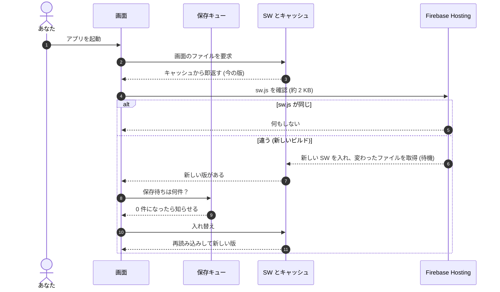

# デプロイとアプリの更新

本番 (Firebase プロジェクト `anoz-memosupo`) への出し方と、出したものがスマホのアプリに
届くまでの流れ。

## 出し方は 2 経路

| 出すもの                                                          | どうやって                                                                                                                                                                               | どこで動くか        |
| ----------------------------------------------------------------- | ---------------------------------------------------------------------------------------------------------------------------------------------------------------------------------------- | ------------------- |
| 画面 (Firebase Hosting)                                           | main に入れば GitHub Actions が自動で出す ([`.github/workflows/deploy-hosting.yml`](../.github/workflows/deploy-hosting.yml))。手で出すときは Actions の «Deploy hosting» → Run workflow | GitHub              |
| Function (`api` / `sheetSync`) と辞書データ (`private/data.json`) | `nr deploy` (画面も一緒に出す)                                                                                                                                                           | **手元の Mac だけ** |

**マージしただけでは本番は変わらない** (画面の CI を入れるまでは、どちらも `nr deploy` だけだった)。

### `nr deploy` が手元でしか動かない理由

`nr deploy` = `build:preview` → `build` → `sync:private` → `sync:functions` →
`firebase deploy --only functions:api,functions:sheetSync,hosting`。
次のものを使い、どれもリポジトリには入っていない (gitignore 済み)。

| もの                               | 中身             | 作り方                                             |
| ---------------------------------- | ---------------- | -------------------------------------------------- |
| Firebase の認証                    | `firebase login` | 手元で 1 回                                        |
| `src/data/words.tsv` / `dates.tsv` | 辞書             | シートから `nr sync`                               |
| `src/data/tags.json`               | タグ             | シートから `nr sync:tags`                          |
| `private/ff.json`                  | hex 用           | シートから `scripts/gen-ff-json.mjs`               |
| `src/data/word-images.json`        | 語と画像の対応表 | 画像の処理 (`images:*`) の結果。**手元にしか無い** |
| `private/kuku.json`                | 九九             | 手元にしか無い                                     |
| `functions/.env`                   | Function の設定  | 手元にしか無い                                     |

Function の秘密の値 (`EDIT_TOKEN` / `GOOGLE_SERVICE_ACCOUNT_JSON`) は Firebase の
Secret Manager にあるので、デプロイする側には要らない。

### Claude のセッションから出すとき

- **クラウドのセッション** (claude.ai/code・スマホアプリから始めたもの。`/home/user/999` に
  GitHub から複製して動く) は、上の手元のものに触れないので `nr deploy` を実行できない。
  できるのは PR のマージまで (画面は CI が出す)。
- **Mac 上のセッション** (Claude Code / Remote Control で 999 のフォルダを開いたもの) なら
  `git pull` → `nr deploy` を頼めば出せる。
- クラウドのセッションから Mac のフォルダにつなぐ (Remote Control のフォルダ共有) には、
  フォルダがホーム直下の隠しフォルダ (`~/.ghq` など) の中に無いことが要る。

どちらで動いているか分からないときは、作業フォルダ (`/home/user/...` か `/Users/...`) で見分けられる。

## 画面の CI の準備 (最初の 1 回)

1. Google Cloud コンソール (プロジェクト `anoz-memosupo`) → IAM と管理 → サービスアカウント → 作成
   (例: `github-hosting-deploy`)。ロールは «Firebase Hosting 管理者»。
   Hosting の rewrites が Function `api` を指しているので «Cloud Functions 閲覧者» と
   «Cloud Run 閲覧者» も付ける
2. そのサービスアカウントの «鍵» → 鍵を追加 → JSON をダウンロード
3. GitHub のリポジトリ → Settings → Secrets and variables → Actions → New repository secret。
   名前 `FIREBASE_SERVICE_ACCOUNT_ANOZ_MEMOSUPO`、値に JSON の中身をそのまま貼る
4. Actions → «Deploy hosting» → Run workflow で 1 回動かして確かめる (ダウンロードした JSON は消す)

CI がやること: `npm ci` → テスト (私的データ `private/ff.json` を読む ffQuiz は除く) →
統計ページの画面ファイルを `src/` から `public/` へコピー (データは本番の `/api/app/stats`
から読むので CI でも欠けない) → `vite build` → Hosting の live に出す。

## 出した版がアプリに届くまで

アプリは PWA。画面のファイルは Service Worker のキャッシュから出していて、期限は無い
(新しい版に入れ替わるまで同じものを出す)。

- **新しい版を探すのは起動したときだけ**。`sw.js` (約 2 KB) を取りに行き、前回と 1 バイトでも
  違えば新しい版がある。`sw.js` にはビルドのたびに各ファイルの中身のハッシュが書き込まれるので、
  バージョン番号を手で上げる作業は無い (vite-plugin-pwa / Workbox の標準のやり方)
- `sw.js` と `index.html` は Hosting で `Cache-Control: no-cache` (`firebase.json`)。古いものが残ることは無い
- 見つかったら、**保存待ち (書き込みキュー) を全部送り終えてから**入れ替えて再読み込みする ([`app/main.tsx`](../app/main.tsx))
- バックグラウンドで定期的に確認しに行くことはしない

## 出た版の確かめ方

アプリの 設定 > タブ の一番上に `版 <コミット> ・ <ビルド日時>` が出る
([`app/components/BuildStamp.tsx`](../app/components/BuildStamp.tsx))。
コミットは CI なら `GITHUB_SHA`、手元なら `git rev-parse` (`vite.config.ts` の `buildStamp`)。
GitHub の main の最新コミットと同じなら反映済み。

反映されないとき:

1. その版がまだデプロイされていないか確かめる (Actions の «Deploy hosting» の実行結果、
   または Firebase コンソールの Hosting の «リリース履歴»)
2. デプロイされていれば、アプリを完全に閉じて起動し直す (起動時の確認で入れ替わる)
